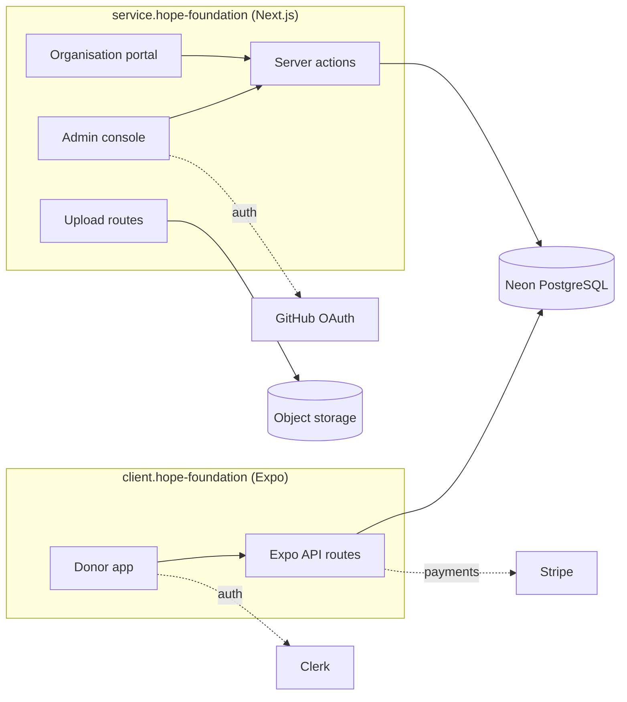

# Hope Foundation

A full-stack charity donation platform that connects donors in South Africa with verified non-profit organisations. Donors give through a mobile app; organisations manage their presence and track donations through a web portal.

Originally built as my final-year project (2024–2025) and revived in 2026 under [Ziaee Technologies](https://github.com/ZIAEE-TECHNOLOGIES), including a work-integrated-learning internship.

## What it does

| Audience | App | Features |
|---|---|---|
| Donors | Mobile (iOS and Android) | Email and Google sign-up, browse organisations, read their updates, donate in Rand with Stripe, view receipts |
| Organisations | Web portal | Donation history, publish posts and donation requests, manage profile, social links and image gallery |
| Administrator | Web portal | Sign in with GitHub, onboard organisations and issue their logins, see totals per donor and organisation |

## Architecture



Both apps share one PostgreSQL database. The mobile app's backend runs as Expo Router API routes; the web app uses Next.js server actions and route handlers.

## Tech stack

| Layer | Technology |
|---|---|
| Mobile | React Native 0.86, Expo SDK 57, Expo Router, NativeWind 4, Zustand, Reanimated |
| Web | Next.js 16 (App Router, server actions), React 19, Tailwind CSS 4, daisyUI 5 |
| Auth | Clerk (donors), Auth.js with GitHub (admin) |
| Payments | Stripe Payment Sheet (test mode) |
| Data | Neon serverless PostgreSQL, AWS S3 for images (moving to Azure Blob Storage) |
| Language and tooling | TypeScript, ESLint, Git with a feature-branch and pull-request workflow |

## Repository layout

```
client.hope-foundation/    Expo mobile app (screens in app/, API routes in app/(api)/)
service.hope-foundation/   Next.js website, organisation portal and admin console
db/                        Schema snapshot, development seed data and ERD
docs/                      Team Git protocol
scripts/                   Small verification scripts
```

## Running locally

Prerequisites: Node.js 20 or newer, a PostgreSQL database (the schema is in `db/schema.sql`), and test keys for Clerk and Stripe.

```bash
# Web portal (http://localhost:3000)
cd service.hope-foundation
npm install
cp .env .env.local      # fill in the values listed in the file
npm run dev

# Mobile app (scan the QR code with Expo Go)
cd client.hope-foundation
npm install
cp .env.example .env    # fill in the values
npx expo start
```

## Status

The platform runs locally against a live database and is being prepared for production: security hardening (password hashing, signed sessions, server-side payment verification), a CI pipeline, web deployment and an Android APK release are in progress.

## Author

**Nadeem Mohammed** · [GitHub](https://github.com/DeemTheDev) · [LinkedIn](https://linkedin.com/in/nadeem-mohammed786)

2026 revival contributions by [@muhammadmiansardar](https://github.com/muhammadmiansardar).
