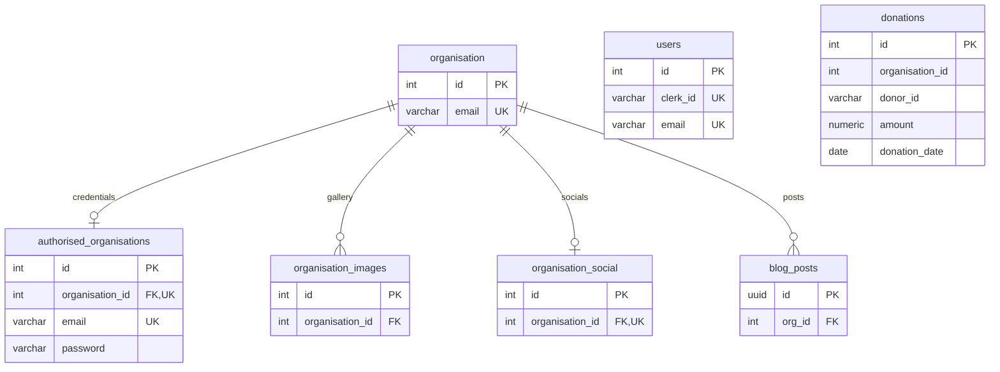

# Development database fixtures

`schema.sql` is a schema-only pg_dump of the public application schema using PostgreSQL 16, with ownership and grants omitted. It contains no customer rows or credentials. It is a snapshot, not a migration to apply over an existing database.

`seed.sql` creates fictional organisations, users, donations, posts and two gallery images. It resolves generated IDs and avoids repeating fixture rows. The script ends in ROLLBACK; fixture donations are not evidence of Stripe payments.

Optional login fixture rows require a private `hope.seed_password` session setting. Never put the actual value in this repository. The existing app still uses the baseline password scheme; follow the scheduled password/security migration before production. Without that setting, no organisation credentials are created.

Validation used one isolated transaction with two seed runs, then rolled back. Persistent seeding and website login are separate runtime checks.

## Verified relationships

The diagram shows foreign keys present in the schema snapshot. Donations contain organisation_id and donor_id used by application queries, but the snapshot declares no foreign keys for them. They are omitted from the enforced-relationship arrows.

Deleting an organisation cascades to blog_posts; other delete rules remain as shown in schema.sql. This documentation does not add constraints or migrate the database.
